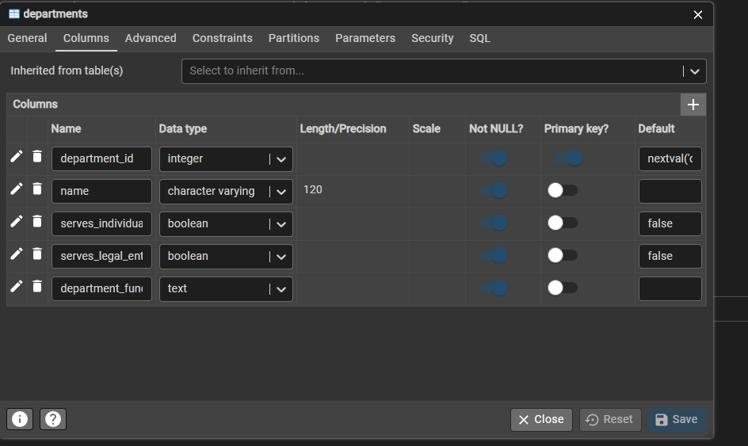
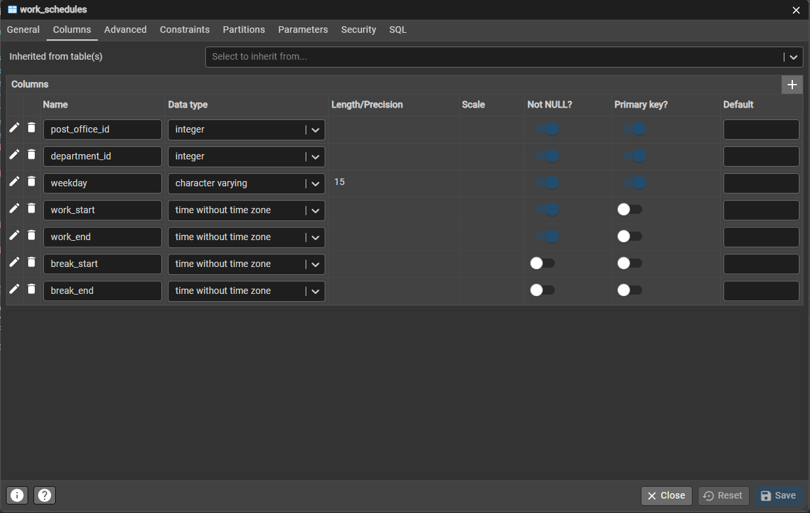
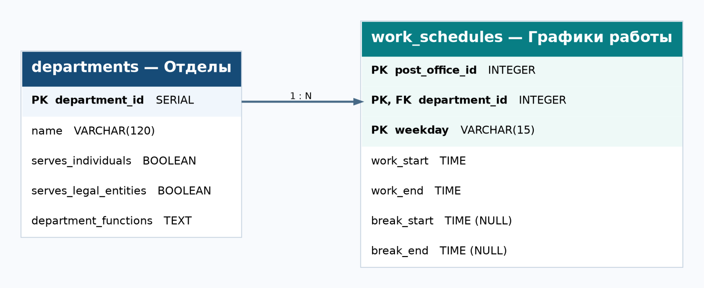

# Лабораторная работа №1

**Тема:** Создание таблиц в PostgreSQL  
**Вариант:** 22  
**СУБД:** PostgreSQL 17  
**Среда:** pgAdmin 4

## Создание базы данных

Создана база данных `lab1_variant22`, содержащая две таблицы: `departments` («Отделы») и `work_schedules` («Графики работы»).

Для создания таблиц использовались SQL-инструкции `CREATE TABLE`.

**Файл:** [create_tables.sql](create_tables.sql)

### Таблица departments

Содержит код отдела, название, признаки обслуживания физических и юридических лиц и функции отдела. `department_id` — первичный ключ с автоинкрементом.

### Таблица work_schedules

Содержит код почтового отделения, код отдела, день недели, время работы и перерыва. Составной первичный ключ: `post_office_id`, `department_id`, `weekday`. Поля перерыва допускают NULL.

## ERD-диаграмма

Связь «один ко многим» по полю `department_id`. Для внешнего ключа предусмотрены `ON UPDATE CASCADE` и `ON DELETE CASCADE`. `post_office_id` хранится без внешнего ключа, потому что третья таблица «Почтовые отделения» не входит в вариант 22.

Дополнительная версия: [erd.svg](erd.svg).

## Заполнение таблиц

Для заполнения подготовлена SQL-инструкция `INSERT INTO`:
12 записей для отделов и 36 для графиков работы (минимум 10 в каждой).

**Файл:** [insert_data.sql](insert_data.sql)

## CSV

Данные (UTF-8, разделитель запятая):
- [departments.csv](departments.csv)
- [work_schedules.csv](work_schedules.csv)
